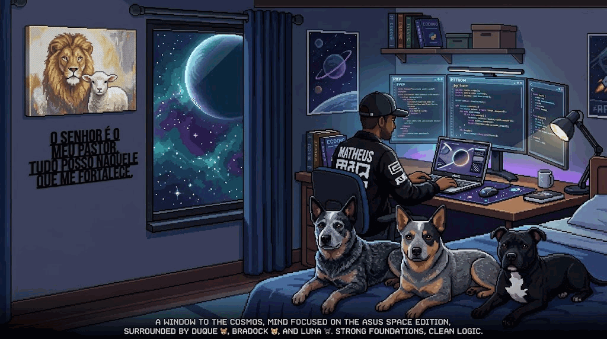

  

    
  

  

    
    
  

  

    
  

  

    
  

  
---

### ⚡ About Me & Philosophy

  
  

- 💼 **Current Role:** Software Developer (Retail Integration) at **Teknisa**, designing complex system communications.
- 🎓 **Education:** Computer Engineering Student at **CEFET-MG**.
- 🚀 **Featured Projects:** Creator of **[GlassHub Engine](https://github.com/matheustheus27/GlassHub-Engine)** & **[GlassHub EventHorizon](https://github.com/matheustheus27/GlassHubEventHorizon)**.
- 🎮 **Background:** Co-developer and project planner of *Bubble* (released on Google Play) at **Commit Jr**.

---

### 🛠️ Core Stack & Technical Architecture

  
  
  

---

### 📊 GlassHub Dynamic Metrics & Activity

  
  
  
  

---

### 🎨 My Universe (The Setup)

  

  <em>A window to the cosmos, mind focused on the Asus Space Edition, surrounded by Duque 🐕, Bradock 🐕, and Luna 🐕. Strong foundations, clean logic.</em>

 

  

